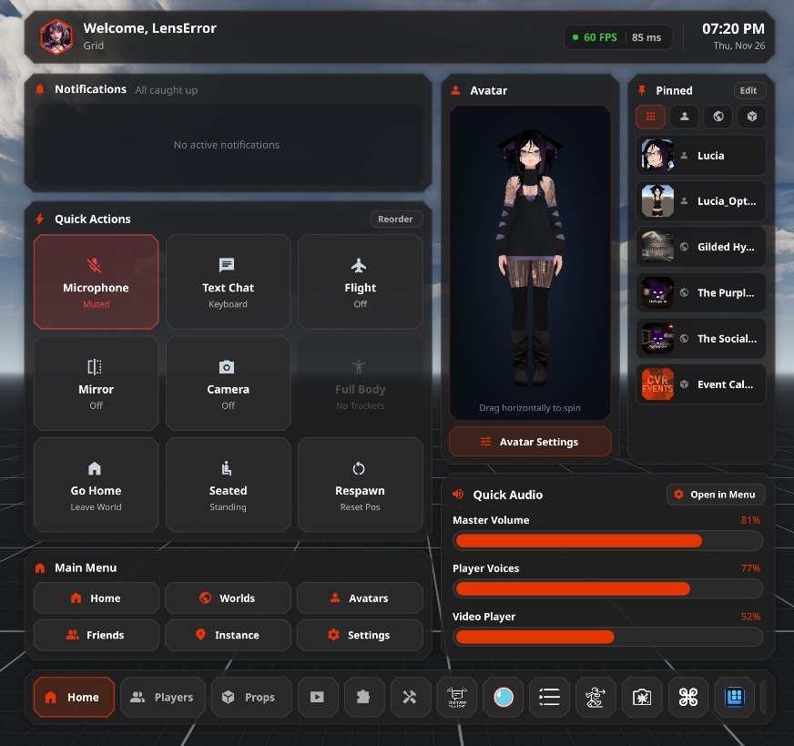
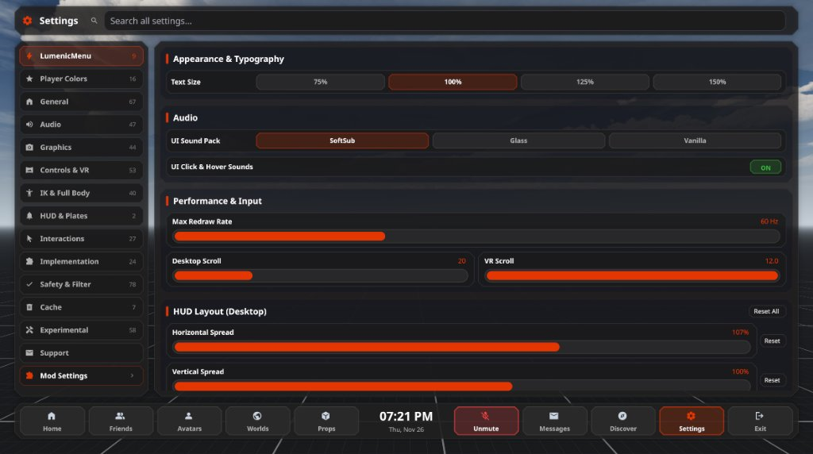

# LumenicMenu

A fast, modern replacement for ChilloutVR's **Main Menu**, **Quick Menu**, and **HUD**, built with a native Rust UI renderer ([Lumenic](https://github.com/LensError/Lumenic)) for smooth performance in both Desktop and VR.

## Installation

1. Make sure **MelonLoader** is installed for ChilloutVR.
2. Download the latest `LumenicMenu.dll` from the [Releases](https://github.com/LensError/Lumenic-CVR-Menu/releases/latest) page.
3. Place `LumenicMenu.dll` into your `ChilloutVR/Mods/` folder.
4. Launch ChilloutVR.

> [!TIP]
> LumenicMenu includes a built-in update checker that notifies you when a new version is available and lets you update directly from inside the game.

## Screenshots

| Quick Menu | Main Menu |
|---|---|
|  |  |

| Settings | World Details |
|---|---|
|  |  |

## Key Features

- **Faster, Smoother Menus:** Replaces the heavy Cohtml web menus with a native renderer that skips idle frames when nothing changes and lets you cap UI refresh rate (`15-144 Hz`).
- **Searchable Settings:** Search across every ChilloutVR setting in one place, with grouped subcategory cards, live dropdowns (Microphone, TTS, World Transitions, Face/Eye Tracking, Video Decoder, Cache), and quick jump to Mod Settings.
- **Unified HUD (Optional):** Clean native HUD for Alerts, Mic Indicator, Notifications, and ChatBox. Customize horizontal/vertical spread and individual element sizes separately for **Desktop** and **VR** with a live preview while adjusting.
- **Quick Menu Pinning & 3D Preview:** Pin up to 60 Avatars, Worlds, and Props next to a live 3D avatar preview, with quick category filters and an Edit mode.
- **Full Mod Compatibility:**
  - **UILib:** Mirrors Quick Menu mod tabs, categories, buttons, toggles, sliders, cycle buttons, text inputs, modals, toasts, colour picker, and player/prop lists (with an optional compact icon-only tab strip).
  - **Mowods:** Full support in Main Menu Mod Settings, including mod/setting search, author/version/assembly info, source links, color-coded mod categories, grouped sections, tooltips, custom Mowods pages/buttons, and Reset buttons.
  - **UIExpansionKit:** Zero-dependency bridge for MelonPreferences, ranges, visibilities, and custom controls. If both Mowods and UIExpansionKit are installed, a header toggle lets you switch between them anytime.
- **Complete Menu Suite:** Home dashboard with optional local Recent History, Content Browser (Avatars, Worlds, Props, Global Search, Discover), Social (Friends, Current Instance, Messages, Profile bio/pronouns editing), Player Colors picker with menu colorizing, Avatar Settings, and reorderable Quick Actions / Quick Tools.

## In-Game Settings & Switching Back

All LumenicMenu options are available inside **Settings -> LumenicMenu** (and in `MelonPreferences` under `LumenicMenu`):

- **Toggle Menus Independently:** Enable or disable the Main Menu, Quick Menu, or HUD separately at any time (also accessible from the `LumenicMenu` Quick Menu tab in both Lumenic and vanilla menus).
- **Appearance & Comfort:** Text Size presets (`75%` / `100%` / `125%` / `150%`), player accent colorizing, click sound pack (`SoftSub`, `Glass`, `Vanilla`), compact icon-only Quick Menu mod tabs, and separate Desktop/VR scroll speeds.
- **HUD Layout:** Separate Desktop and VR horizontal/vertical spread plus individual sizes for Alerts & Icons, Mic Icon, Notifications, and ChatBox, each with individual Reset and Reset All buttons.
- **Performance & Privacy:** Configurable UI refresh cap (`15 - 144 Hz`), optional local Recent History toggle, and one-click clear for local history data.

> [!NOTE]
> If you run into a base-game issue and want to verify whether it is caused by a mod, toggle LumenicMenu off or remove `LumenicMenu.dll` from `ChilloutVR/Mods/` and restart the game.

---

## For Mod Developers (`LumenicMenu.Api`)

LumenicMenu ships with a C# Extension API (`LumenicMenu.Api`) so third-party MelonLoader mods can build native Lumenic UI alongside (or without replacing) BTKUILib:

- Add custom **Quick Menu** (`800x800`) and **Main Menu** (`1280x720`) tabs, sub-pages, and modals using a declarative `UiBuilder`.
- Inject into, restyle, hide, or replace built-in Lumenic sections (`qm.home.banner`, `qm.home.actions`, `qm.player_details.actions`, `mm.settings.lumenic`, etc.).
- Override global theme tokens (typography, font scale, colors, spacing, custom `.ttf`/`.otf` fonts) via `LumenicApi.Theme`.
- Upload PNG/JPG bytes, remote URLs, raw RGBA buffers, or live Unity `Texture2D` frames.

### Soft-Dependency Quick Start

Reference `LumenicMenu.dll` with `<Private>false</Private>` and isolate API calls behind `[MethodImpl(MethodImplOptions.NoInlining)]`:

```csharp
[assembly: MelonOptionalDependencies("LumenicMenu")]

public override void OnLateInitializeMelon()
{
    if (MelonBase.RegisteredMelons.Any(m => m.Info.Name == "LumenicMenu"))
        LumenicIntegration.Initialize(this);
}
```

See the full guide and widget reference in [docs/EXTENSIONS.md](docs/EXTENSIONS.md).

---

## Architecture & Building from Source

### Architecture
- **C# (`Main.cs`, `Bridge/`, `Api/`, `Hud/`):** Owns all ChilloutVR/Unity/MelonLoader APIs, state snapshot serialization, mod bridges (UILib, Mowods, UIExpansionKit), and action dispatch.
- **Rust (`native-ui/`):** Pure UI layout and offscreen rendering built on `lumenic`, compiled to `lumenic_cvr_ui.dll` and embedded directly inside `LumenicMenu.dll`.

### Requirements
- ChilloutVR with MelonLoader installed
- `CVRPath` environment variable pointing to your ChilloutVR install directory
- Rust toolchain (`cargo`)
- .NET SDK supporting `netstandard2.1`

### Build & Test

```powershell
# Point CVRPath to your ChilloutVR folder (once per shell or set in system env vars)
$env:CVRPath = "C:\Program Files (x86)\Steam\steamapps\common\ChilloutVR"

# Build Rust UI + C# mod DLL (auto-embeds lumenic_cvr_ui.dll and copies LumenicMenu.dll to $(CVRPath)/Mods/)
dotnet build LumenicMenu.csproj -c Release

# Run Rust UI integration & FFI tests
cd native-ui
cargo test
```

---

> [!IMPORTANT]
> **Disclaimer:** Modding ChilloutVR is [officially allowed](https://docs.chilloutvr.net/official/legal/tos/#6-modding-our-game) per the ChilloutVR Terms of Service. However, **this modification is unofficial and not affiliated with ChilloutVR or the ChilloutVR team. Using it might cause issues with performance, security, or stability of the game.** Use it at your own risk.

> [!NOTE]
> Found a bug or want to request a feature? Open an issue or pull request on GitHub, or DM `@LensError` on Discord.
