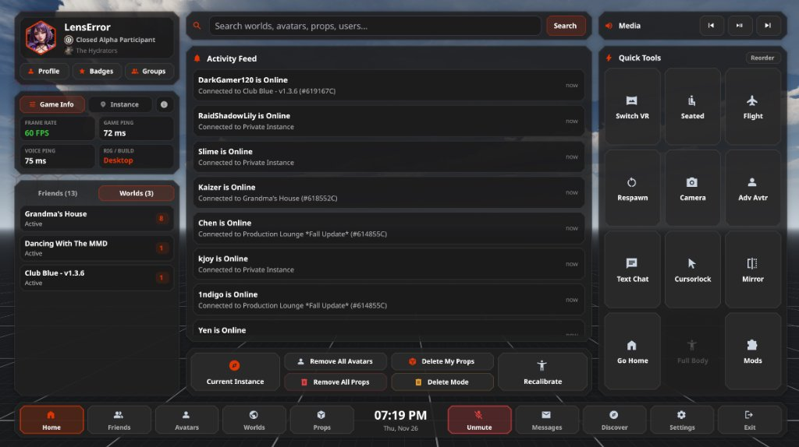
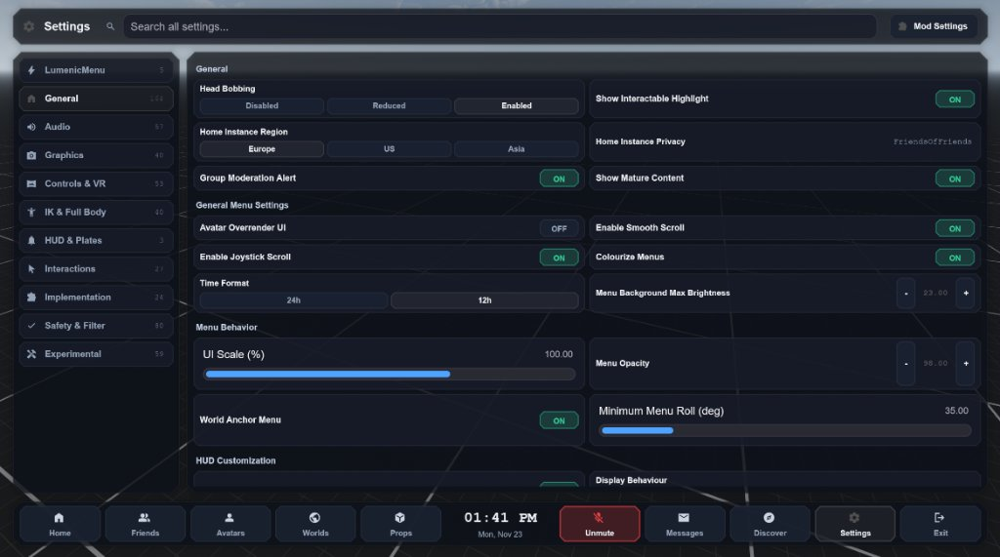
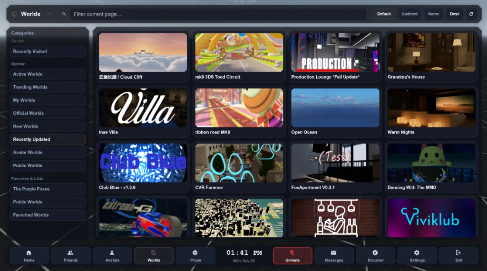
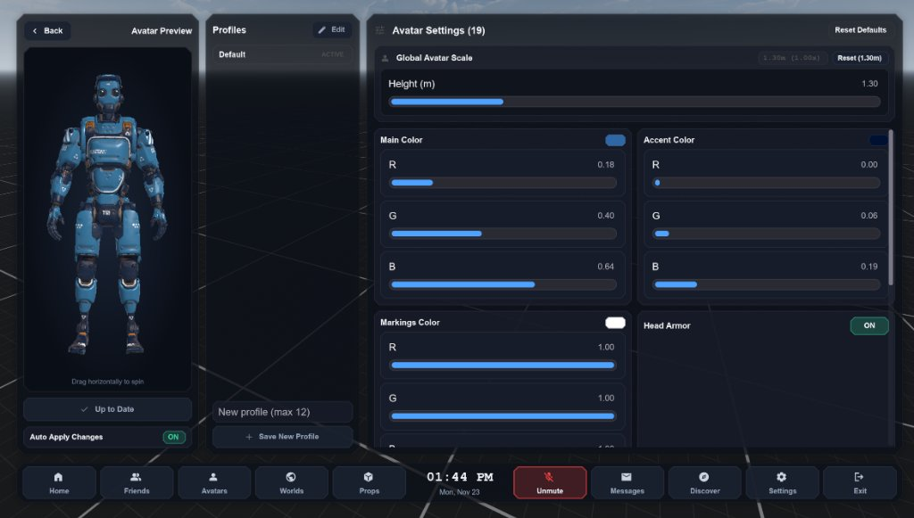
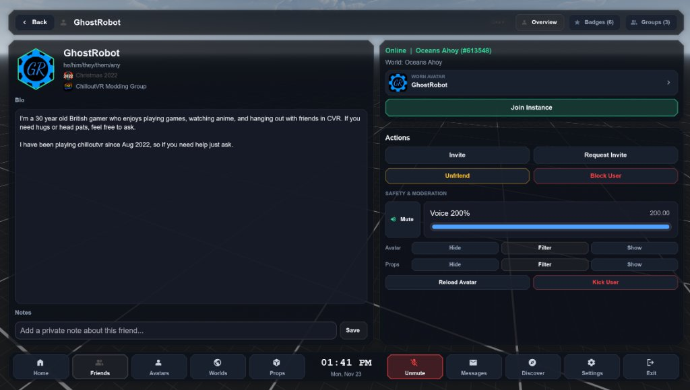
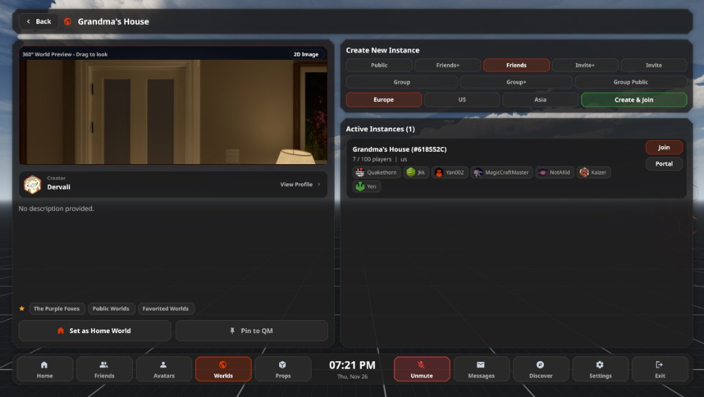
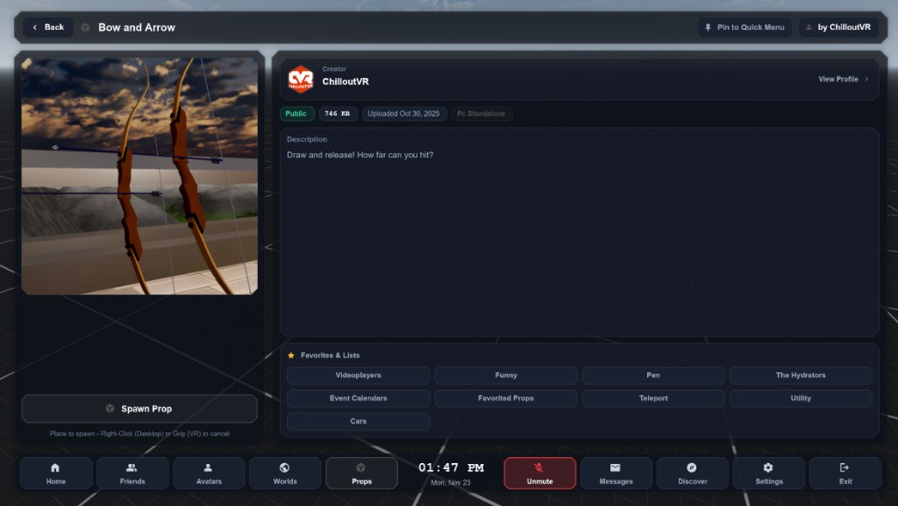

# LumenicMenu

A MelonLoader mod for ChilloutVR that replaces the Cohtml-based Main Menu and Quick Menu with a native Rust UI built on [Lumenic](https://github.com/LensError/Lumenic), rendered offscreen and uploaded to Unity textures.

## Screenshots

| Quick Menu (Pinned & 3D Avatar) | Main Menu (Home Dashboard) |
|---|---|
|  |  |

| Settings (Live Search) | Worlds Browser |
|---|---|
|  |  |

| Avatar Settings | User Profile & Moderation |
|---|---|
|  |  |

| World Details (360° Preview & Pinning) | Prop Details & Pinning |
|---|---|
|  |  |

## What It Adds Over the Vanilla Menu

- **Search in Settings**: Live search bar across all ChilloutVR settings categories in one view, with quick switching between Vanilla Settings and Mod Settings.
- **Pinning in Quick Menu**: Pin up to 60 Avatars, Worlds, and Props into a dedicated Quick Menu card next to the 3D avatar turntable, with All / Avatars / Worlds / Props filters and an Edit mode to unpin (`UserData/LumenicMenu/pinned-items.json`).
- **Native Rust Renderer**: Replaces Cohtml web views with offscreen `lumenic` rendering, idle-frame skipping, and a configurable refresh rate cap (`15-144 Hz`).
- **Mod Ecosystem Bridges**:
  - **UILib**: Mirrors Quick Menu mod tabs, categories, buttons, toggles, sliders, cycle buttons, text inputs, modals, toasts, colour picker, and player/prop lists.
  - **UIExpansionKit**: Reflection bridge (no hard dependency) rendering MelonPreferences, ranges, visibilities, and custom controls in Main Menu Mod Settings.
- **Complete Menu Suite**: Home dashboard with optional local recent history, 3D avatar preview rig, Content Browser (Avatars, Worlds, Props, Global Search, Discover), Social (Friends, Current Instance, Messages, local Profile bio/pronouns editing), Player Colors picker with CVR theme & tame panel colorizing, Avatar Settings, and reorderable Quick Actions / Quick Tools.

## Usage & Controls

- **Independent Toggles**: Both menus are enabled by default. You can disable or re-enable the Main Menu and Quick Menu separately via `MelonPreferences` (`LumenicMenu`) or under the `LumenicMenu` Quick Menu tab (works in both Lumenic and vanilla menus).
- **Key Settings** (`Settings -> LumenicMenu` / `MelonPreferences`):
  - `EnableMainMenu` / `EnableQuickMenu` (`true` by default, toggled in the `LumenicMenu` QM tab)
  - `UiClickSounds` / `UiSoundPack` (default `SoftSub`, options: `SoftSub`, `Glass`, `Vanilla`)
  - `MaxRefreshHz` (`15` - `144`, default `60`)
  - `DesktopScrollMultiplier` / `VrScrollMultiplier`
  - `EnableRecentHistory` (`true` by default; toggle local `Recent` categories and clear local `UserData` directly from Settings)
  - `UiScale` (`0.5` - `2.0`, default `1.0`)

## Building from Source

### Requirements
- ChilloutVR with MelonLoader installed
- `CVRPath` environment variable pointing to your ChilloutVR install directory
- Rust toolchain (`cargo`)
- .NET SDK supporting `netstandard2.1`

### Build
```powershell
dotnet build LumenicMenu.csproj -c Release
```
This automatically builds `native-ui` (`cargo build --release`), embeds `lumenic_cvr_ui.dll` into `LumenicMenu.dll`, and copies the output to `$(CVRPath)/Mods/`.

> [!IMPORTANT]
> **Disclaimer**: Modding ChilloutVR is [officially allowed](https://docs.chilloutvr.net/official/legal/tos/#6-modding-our-game) per the ChilloutVR Terms of Service. However, **this modification is unofficial and not supported by ChilloutVR or the ChilloutVR team. Using it might cause issues with performance, security, or stability of the game.** Use it at your own risk.

> [!NOTE]
> If you encounter any issues or bugs, or want to make a feature request, please open an issue or pull request on GitHub, or DM me on Discord (`@LensError`).
